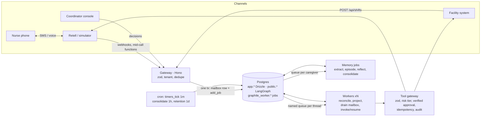

# 01 · Architecture

## The one-paragraph version
Every input (a nurse's SMS, a Retell call result, a facility posting a shift, a coordinator's
click, a timer firing) enters through the **gateway**. In one Postgres transaction the gateway
writes it to the target thread's **mailbox** and enqueues a **kick job** (graphile-worker's
`add_job` is a SQL function, so the job table *is* the transactional outbox), then returns 200.
A **worker** picks up the kick. Jobs in the named queue `thread:<id>` run one at a time. The
worker reconciles the thread's bookkeeping with its **LangGraph checkpoint**, drains the mailbox
and starts or resumes the graph. The graph runs until `interrupt()`: waiting for a reply, a timer,
a child thread or a human. Nothing is held in memory while it waits, possibly for hours.
Side effects go through the **tool gateway** (validated, risk-tiered, idempotent, audited).
Long-term **memory** is read before decisions and written by background jobs.

## Components

| Component | File | Scales by |
|---|---|---|
| Gateway | `src/gateway.ts` | stateless replicas |
| Workers (thread + memory jobs + cron) | `src/tasks.ts`, `src/worker.ts` | more processes; graphile hands out jobs with `SKIP LOCKED` |
| Graphs | `src/graphs/*.ts` | code; state lives in checkpoints |
| Schema / migrations | `src/db/schema.ts`, `drizzle/` | — |

Every process is stateless. Any of them can die at any moment and its work is retried.

## Three owners, one database
| Schema | Owner | Contents |
|---|---|---|
| `app` | **Drizzle** (`schemaFilter: ["app"]`) | Domain (agencies, facilities, nurse profiles, shifts) and control plane (agent_runs, mailbox, timers, approvals, offers, tool_calls, comms_log) |
| `public` | **LangGraph** (`PostgresSaver.setup`, `PostgresStore.setup`) | Checkpoints (short-term memory), long-term memory store + pgvector |
| `graphile_worker` | **graphile-worker** (`runMigrations`) | Jobs, named queues, cron bookkeeping |

One database means "change state + enqueue the follow-up" is one transaction. drizzle-kit never
sees the other two schemas. Things Drizzle can't express (`CREATE EXTENSION`, the exclusion
constraint) live in a hand-written migration: `drizzle/0001_invariants.sql`.

## The life of one SMS: "YES 4309"
1. **`POST /webhooks/sms`**: zod validates the body (400 on bad input; a 500 would make the provider retry forever).
   The dialed number identifies the **tenant** (`agencies.phone`), and `messageId` is deduped (`inbound_requests`).
2. **Correlate**: phone → nurse → open offer (by code) → `fill:<shiftId>` thread. If there's no offer
   but an open conversation exists, it becomes a `nurse_message` to it ("double texting");
   otherwise a new Intake thread is started.
3. **One transaction**: mailbox row (`nurse_reply`) + `add_job('thread_kick', queue 'thread:<id>', job_key 'kick:<id>')`. Return 200.
4. **Worker** runs `processThread`:
   - bump the **lease version** (fencing token);
   - **reconcile** inflight events against the checkpoint;
   - **project** status and approvals from the checkpoint.
5. **Drain**: the graph is paused at `wait`, which `accepts: ["nurse_reply","timer","cancel"]`. Take the
   oldest matching event, mark it `inflight` with the interrupt id, and call
   `invoke(new Command({ resume: event }), { durability: "sync" })`.
6. **Graph**: `wait` → `interpret` (LLM parses the reply; the result is checkpointed) → `handle_event`
   (replay-safe offer update) → `check_policy` (no risks → `policy:auto`) → `book`. The booking runs
   in **one transaction** (claim + update + result) → confirmation SMS → `finish` (withdraw other offers;
   episode jobs and the parent's `child_done` in one transaction).
7. **Next loop pass**: reconcile marks the event `consumed` (the checkpoint moved past its interrupt),
   projection marks the run `done`. The parent thread got its own kick in step 6.

## Two graphs, two orchestration patterns
**Intake (supervisor)**, one thread per conversation: `identify_caller → classify → route`.
- Emergency → human (a keyword rail in code, before any model).
- Low confidence → human triage.
- Call-out → `spawn_children` → `wait_children ⇄ collect` → `summarize`.

**ShiftFill (long-running worker agent)**, one thread per shift (`fill:<shiftId>`):
`load_shift → find_candidates → score_candidate×N (Send) → rank → prepare_wave → review_drafts →
send_wave → wait → interpret → handle_event → check_policy → approval → book → finish`,
plus `escalate`, and `cancel` at every pause.

**Why child threads instead of a subgraph?**
- Each shift gets its own durable unit: its own queue, retries, timeline and approvals.
- A failed shift doesn't block its siblings. It reports `child_done{failed}` and a human is paged.
- The natural id `fill:<shiftId>` makes duplicates impossible.

Use `Send` for in-graph parallel map-reduce (`score_candidate`). Use a subgraph for short work
that shares the parent's lifecycle.

## Data model (app schema)
| Table | Purpose |
|---|---|
| `agencies`, `facilities`, `caregivers`, `shifts` | Mock facility scheduling system. **Nurse profile** = `caregivers` row. `shifts` has the `no_overlapping_bookings` EXCLUDE constraint |
| `agent_runs` | Thread lifecycle *projection*: graph + **graph_version**, subject (natural key), parent, status, waiting_for, lease_owner, **lease_version**, heartbeat |
| `thread_inbox` | **Mailbox**: pending → inflight (+`resumed_interrupt_id`) → consumed / ignored / stale; `dedupe_key` unique |
| `timers` | Durable timers (wave timeout, hard deadline, children deadline) |
| `approvals` | HITL inbox *projection*; `interrupt_id` unique; pending / decided / stale / cancelled |
| `offers` | Correlation of replies to threads; `last_event_id` makes transitions replay-safe |
| `tool_calls` | Tool audit log **and** idempotency cache |
| `comms_log`, `inbound_requests` | Message log (simulator + audit); webhook dedupe |
| `outbox` | Used only by the RabbitMQ reference implementation |

## Key choices (and the alternatives to mention)
| Choice | Why | Alternatives |
|---|---|---|
| LangGraph.js | Explicit state machine; `interrupt`/`Command`/`Send`; Postgres checkpointer + store | Mastra (TS-first workflows with suspend/resume, built-in memory); Temporal / Restate / Inngest for durable execution of arbitrary code; a hand-rolled harness |
| graphile-worker | Transactional enqueue, per-key serial queues, retries, cron, all in the DB we already run | RabbitMQ + outbox (`src/reference`) when consumers aren't Postgres-centric; Kafka for replayable streams; SQS; pg-boss |
| Drizzle | Typed queries and schema-as-code with generated SQL migrations; raw `sql` where SQL is clearer (SKIP LOCKED, array ops, distance) | Prisma (heavier, weaker raw SQL), Kysely (query builder only) |
| Checkpoint = source of truth | `agent_runs`/`approvals` are projections rebuilt every drain, so crash windows heal themselves | Writing the status "after a clean run" (the bug the review found) |
| DB invariants | No-overlap EXCLUDE constraint, unique dedupe keys, natural thread ids | Checks in agent code only, which races between threads |
| Retell for voice | Outbound call API, dynamic variables, mid-call functions, post-call analysis; $10 free credit | Vapi ($5; free numbers are inbound-only); Twilio + your own STT/TTS |
