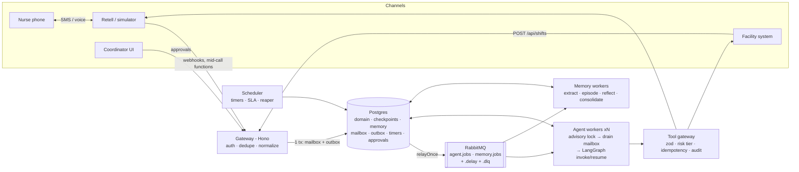

# 01 · Architecture

## The one-paragraph version
Every input (a nurse's SMS, a Retell call result, a facility posting a shift, a coordinator's
click, a timer firing) enters through the **gateway**. The gateway writes it to the target
thread's **mailbox** and an **outbox** row, in one Postgres transaction, then returns 200.
A relay publishes outbox rows to **RabbitMQ**. A **worker** takes the thread's **advisory lock**,
drains the mailbox, and starts or resumes the thread's **LangGraph** graph. The graph runs until
it hits `interrupt()`: waiting for a reply, a timer, a child thread, or a human. Its state is
**checkpointed** in Postgres, so nothing is held in memory while it waits, possibly for hours.
Side effects go through the **tool gateway** (validated, risk-tiered, idempotent, audited).
Long-term **memory** is read before decisions and written in the background.

## Components

| Component | File | Scales by | State |
|---|---|---|---|
| Gateway | `src/gateway.ts` | stateless replicas | none (Postgres) |
| Outbox relay | `src/outbox.ts` `relayOnce` | N replicas (SKIP LOCKED) | none |
| Agent worker | `src/worker.ts` | competing consumers on `agent.jobs` | none (checkpoints in Postgres) |
| Memory worker | `src/memory.ts` `handleMemoryJob` | competing consumers on `memory.jobs` | none |
| Scheduler | `src/timers.ts` | N replicas (SKIP LOCKED) | none |
| Graphs | `src/graphs/*.ts` | code (pure-ish functions + checkpointer) | Postgres checkpoints |

Every process is stateless, which is the point. Any of them can die at any moment.

## The life of one SMS: "YES 4309"

1. **Twilio/Retell → `POST /webhooks/sms`** (`gateway.ts`). Dedupe on `messageId`
   (`inbound_requests`), because providers retry.
2. **Correlate.** Look up the phone → caregiver → open offer (by code) → `thread_id`.
   No open offer? Then it's a new conversation and an **Intake** thread is started.
3. **One transaction.** `thread_inbox` row (kind `nurse_reply`) + `outbox` row (`thread.kick`). Return 200.
4. **Relay** publishes the kick to RabbitMQ exchange `vali` → queue `agent.jobs`.
5. **Worker** (`processThread`): `pg_try_advisory_lock(hashtext(thread_id))`. If it's busy,
   `RetryLater` sends the job to the delay queue (2s), then back.
6. **Drain the mailbox** (`drainMailbox`). The graph is paused at `wait` with
   `accepts: ["nurse_reply","timer"]`, so the worker takes the oldest matching event and calls
   `graph.invoke(new Command({ resume: event }), { durability: "sync" })`.
7. **Graph.** `wait` returns the event → `handle_event` parses the reply (LLM gateway)
   → `Command(goto="check_policy")` → no risks → `book` → tool gateway
   `scheduler.book_shift` (needs `approvedBy`; here `policy:auto`) → confirmation SMS,
   withdraw other offers → `finish` → episodes for memory + `child_done` to the parent's mailbox.
8. **Worker** marks the event consumed, records the run as `done`, then drains again:
   the parent thread gets its own kick through the outbox.

Latency budget: the gateway answers in milliseconds. The agent's work is async, which is
fine because the nurse is texting, not waiting on a spinner.

## Two graphs, two orchestration patterns

**Intake (supervisor)**: `identify_caller → classify → route`
- emergency → human (keyword rail in code, never the model alone)
- low confidence → human triage review
- call-out → `spawn_children` → `wait_children ⇄ collect` → `summarize`

**ShiftFill (long-running worker agent)**: `load_shift → find_candidates →
score_candidate×N (Send) → rank → prepare_wave → review_drafts → send_wave → wait ⇄
handle_event → check_policy → approval → book → finish`, plus `escalate` from
several places.

**Why child *threads* instead of a subgraph?** Each shift gets its own durable unit:
its own lock, retries, timeline, metrics and human inbox entries. A slow or failed shift
never blocks its siblings, and you can resume, inspect or cancel one shift on its own.
The parent waits on `child_done` mailbox events (a fan-in barrier). Use a **subgraph** when
the child is short-lived and shares the parent's lifecycle. Use **`Send`** for in-graph
parallel map-reduce, as `score_candidate` does.

## Data model (Postgres)

| Table | Purpose |
|---|---|
| `agencies`, `facilities`, `caregivers`, `shifts` | Mock of the facility scheduling system. **Nurse profile** = `caregivers` row (licenses, certs, specialties, languages, bio, min rate, max distance, shift preferences, channel, contact hours, reliability) |
| `checkpoints`, `checkpoint_writes`, `checkpoint_blobs` | LangGraph short-term memory (per thread, per super-step) |
| `store`, `store_vectors` | LangGraph long-term memory (namespaced JSON docs + pgvector embeddings) |
| `agent_runs` | Thread lifecycle: graph, parent, status, waiting_for, heartbeat |
| `thread_inbox` | **Mailbox**: every event for a thread; `dedupe_key` unique |
| `outbox` | Transactional outbox → RabbitMQ |
| `timers` | Durable timers (wave timeout, hard deadline) |
| `approvals` | HITL inbox; `interrupt_id` unique |
| `offers` | Correlation of SMS/call replies → thread (`YES 4821`) |
| `tool_calls` | Tool audit log **and** idempotency cache |
| `comms_log` | Every message sent/received (simulator + audit) |
| `inbound_requests`, `dead_letters` | Webhook dedupe; poison jobs |

## Key choices (and the alternatives to mention)

| Choice | Why | Alternatives |
|---|---|---|
| LangGraph.js | Explicit state machine, `interrupt`/`Command`/`Send`, Postgres checkpointer + store. Widely understood vocabulary | **Mastra** (TS-first; workflows with suspend/resume, built-in working memory + semantic recall). **Temporal / Inngest / Restate** for true durable execution of arbitrary code. A hand-rolled harness (what Vali actually did) |
| Postgres for everything | One transaction for state change + job; pgvector for memory; fewer moving parts | Redis for locks/queues, a vector DB (Pinecone, Qdrant) at larger scale |
| RabbitMQ | Job semantics: ack, delayed retry, DLQ, competing consumers | Kafka (event log, replay, partitions); SQS (managed); pg-boss/graphile-worker (queue inside Postgres) |
| Mailbox per thread | Ordering, buffering of events the graph can't use yet, dedupe, one place to see "what happened to this thread" | Resuming directly from webhooks (racy) |
| Child threads | Isolation and independent durability per shift | Subgraphs / `Send` inside one thread |
| Retell for voice | Outbound call API, dynamic variables, mid-call functions, post-call analysis; $10 free credit | Vapi ($5 credit; free numbers are inbound-only), raw Twilio + your own STT/TTS |
